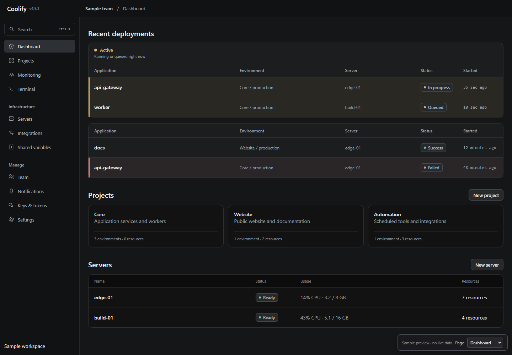
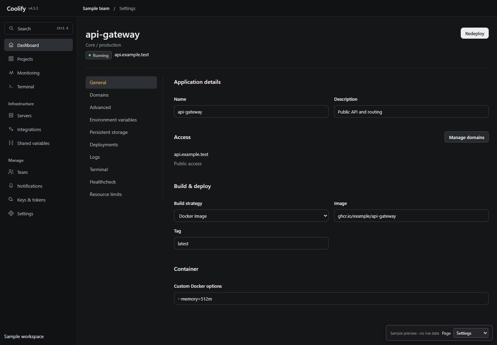

# Coolify Beacon — Classic Center

Beacon redesigns the presentation of Coolify's main interface through [Stylus](https://github.com/openstyles/stylus). It puts deployment activity, resource identity, domains, health, and operational data in a readable central work area.

The theme supplies its own palette. Install it once in each browser; no Coolify appearance settings or color codes are required.

**Stylus is the only extension required.** The classic resource layout uses menu and header elements that current Coolify already renders.

## Deployments at a glance

A deployment that is running or queued gets an amber edge and tint across its whole row; a failed one gets red. Finished deployments stay quiet, so anything that needs attention stands out. This applies on the dashboard, in each application's deployment history and in the compact history beside a deployment log. The dashboard's Active panel has an amber heading, the deployment log shows its state as a coloured label, and the top-bar deployments counter becomes an amber button while anything is building.

## Install

1. Install the [Stylus extension](https://github.com/openstyles/stylus#releases).
2. Open [beacon.user.css](https://raw.githubusercontent.com/ncjsvr/Coolify-Beacon-Style/main/beacon.user.css).
3. Leave **Check for updates** enabled and click **Install style**.
4. Reload your Coolify page. If an older manually pasted Beacon style is enabled, disable that duplicate.

If an older design remains visible, check the version in Stylus and use **Update style**. Version **3.3.0** makes running, queued and failed deployments stand out everywhere and extends the classic layout to servers, databases, services and integrations.

## Classic resource layout

On wide screens, Beacon restores Coolify's rendered page-side configuration menu beside the form on applications, databases, services, servers and integration pages (sources, destinations, S3 storage). The existing resource name, running/health state, links, and action control are shown in the main page header. Open form sections have a flatter presentation closer to older Coolify versions.

The local menu appears from 1280px upward on resource workspaces that contain it. Logs and full-screen canvases keep their focused layouts. Mobile continues using Coolify's native navigation.

While that configuration menu is showing, the left sidebar keeps Coolify's global menu instead of a second copy of the configuration links: Dashboard, Projects, Terminal, Servers and Tags, then Monitoring, Integrations, Shared Variables, Team, Notifications, Keys & Tokens and Settings. Each of those groups links straight to its first page (Team opens Team → General, for example), where Coolify's own sidebar shows the rest of the group, as in older versions' flat menu. Below 1280px, on logs and on canvases, the sidebar keeps Coolify's native behaviour.

This is a CSS restoration of existing elements, not a server rollback. The exact old horizontal task strip and standalone Restart/Stop buttons cannot be recreated reliably with CSS alone; those actions remain in the current working action menu, including their original confirmations.

The same file works across Coolify hostnames. Every rule requires Coolify's branded app shell before it applies; the public stylesheet contains no instance address or credentials.

Only `beacon.user.css` is installed in Stylus. Tampermonkey is not required.

## What changes in Coolify

| Page or section | Treatment |
| --- | --- |
| Main shell and navigation | Quiet graphite surfaces, aligned navigation icons, compact navigation rows, distinct selected state, and a wider central content column. The desktop header has 32px of clearance below its fixed 48px bar. Mobile uses the existing in-flow header with 24px of page spacing. |
| Dashboard | Deployments and activity span the content width above Projects and Servers on wide screens. Application names, environment, server, status, and start time remain visible in the existing responsive table. Running and queued rows get an amber edge and tint, failed rows red; the Active panel heading is amber. Server usage bars are neutral, and a server needing attention shows its status in amber. |
| Projects and environment resources | Calmer resource tiles, quieter icon frames, readable descriptions/domains/server names, and consistent table row spacing. Grid/table view choices and native responsive columns are preserved. |
| Applications, services, databases, and servers | The native resource identity, status, links, and action control return to the main page header on wide screens. Existing local configuration menus appear beside flatter forms. The duplicate desktop action HUD is hidden only when its in-page header is restored. |
| Deployment history and logs | Readable headers, 48px data rows, clear separators and status badges, and restrained hover feedback. Running and failed rows carry their state colour; the log header shows the state as a coloured label. Native full-history columns and compact history beside deployment logs retain their different responsive layouts. |
| Environment variables | Monospaced keys, clearer row separation and field contrast. Secret masking, per-variable actions, compact inputs, mobile layout, and unsaved-state controls keep their native behavior. |
| Fleet and resource metrics | Consistent section hierarchy, tabular figures, quieter chart labels and grid lines. Actual chart series, live data, and ranges remain controlled by Coolify. |
| Runtime logs | Neutral dark output panels, readable monospace output/timestamps, quiet toolbars, and a viewport height coordinated with the page header. Virtualized log row positions and sizes remain native. |
| Terminal | Calmer target picker cards and readable group labels. Session controls remain available; terminal rendering and console theme stay under Coolify's control. |
| Shared controls and popovers | Neutral secondary buttons, an off-white primary action, readable fields and menus, checkboxes beside their labels, dotted underlines on headings with help hints, neutral scrollbars, and visible keyboard focus. Real warning, success, and failure states retain amber, green, and red. |

Beacon is CSS. It can restyle and arrange information already rendered by Coolify; it cannot fetch additional dashboard data, change server-side item limits, rewrite application copy, or add working actions. Full-bleed canvases, collapsed navigation, view toggles, and responsive deployment/log layouts keep their native behavior.

## Design direction

- **Product:** direct control over self-hosted applications and infrastructure.
- **Character:** steady, exact, practical.
- **World:** an operations console used for routine checks and failed deployments.
- **Moments:** active deployment state and real resource metrics carry color.
- **Signature:** Coolify's native status dots paired with tabular operational timestamps.

The overhaul removes decorative heading indicators, colored button glows, heavily tinted backgrounds, unnecessary card lift, and oversized text weights. It uses a 4px spacing scale, three text roles, native Geist/Reicon, and surface changes for depth. Existing labels and icons are preserved; the only generated text is each sidebar group's own Coolify name on its shortcut link.

| Design pass | Applied to the Coolify interface |
| --- | --- |
| Spacing | Consistent navigation, section, table, and form rhythm; header clearance follows the real desktop/mobile shell. |
| Color | Graphite surfaces and three text roles. Color marks real operational state. |
| Icons | Native Reicon remains, with aligned sizes and quieter resource icon frames. |
| Copy | Existing labels remain. No invented metrics or headings; sidebar group shortcuts reuse Coolify's own group names. |
| Type | Native Geist, lighter headings, readable secondary text, and tabular operational figures. |
| Layout | Wider central data area, full-width dashboard activity, prominent resource headers, and restored local configuration navigation on wide screens. |
| Details | Clear status badges, neutral selection, keyboard focus, and restrained field/menu borders. |
| Visuals | Actual deployment state and metric charts carry the visual emphasis. No generated decoration. |
| Motion | Quick surface/color feedback replaces card lift and decorative glow. Reduced-motion preferences are respected. |

## Compatibility

Before each release the stylesheet is checked in a headless browser against Coolify's compiled stylesheet, and on a live v4.5.3 instance. The screenshots use sample data, not a real installation.

The stylesheet targets **Coolify v4.5.3**. Its layout decisions are based on the versioned [app shell](https://github.com/coollabsio/coolify/blob/v4.5.3/resources/views/layouts/app.blade.php), [dashboard](https://github.com/coollabsio/coolify/blob/v4.5.3/resources/views/livewire/dashboard.blade.php), and shared resource/table/log components. Future Coolify releases may require selector updates.

## Updates

Stylus checks the public GitHub update URL every **24 hours by default**. You can change the interval in Stylus settings or request an update manually. Keep **Check for updates** enabled on each installed copy.

Each CSS release increases the UserCSS version number. GitHub's raw-file cache can briefly serve the previous file after a push. See [Stylus update settings](https://github.com/openstyles/stylus/wiki/Options) and [UserCSS metadata](https://github.com/openstyles/stylus/wiki/Writing-UserCSS).

## Design process credit

This redesign applies **Unslop by Damir Sokolovsky ([@heydamir](https://x.com/heydamir))**, [CC BY 4.0](https://creativecommons.org/licenses/by/4.0/). [Unslop](https://heydamir.design/unslop)
